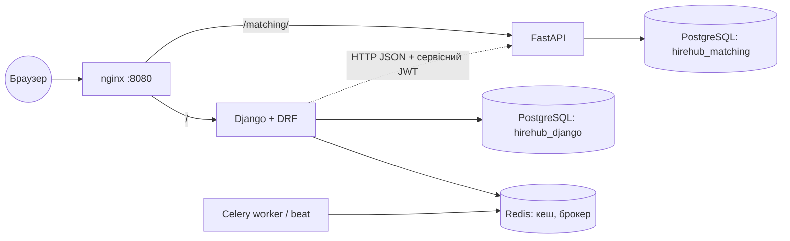

# HireHub — платформа пошуку роботи та рекрутингу

Індивідуально-консультаційна робота (ІКР) з дисципліни «Розробка вебдодатків на Python», **варіант 15**:
вебзастосунок на **Django з REST API (DRF)** та окремий вебсервіс **«Matching Service» на FastAPI**,
які працюють разом, мають власні БД, автентифікацію, тести, контейнеризацію й документацію.

> **Використання засобів генерації коду.** Код проєкту створено у співпраці з AI-асистентом.
> Автор роботи відповідає за розуміння кожного фрагмента й пояснює його під час захисту (див. `docs/defence.md`).

## Предметна область

Компанії публікують вакансії, кандидати створюють профіль із навичками та подають заявки, роботодавець веде заявки за статусами
(`подана → переглянута → співбесіда → пропозиція / відмова`) і призначає співбесіди. Окремий сервіс підбирає відповідності
**за навичками** (коефіцієнт Жаккара / косинусна подібність) і пояснює, які навички збіглися, а яких бракує.

| Роль | Можливості |
|---|---|
| Кандидат | профіль, навички з рівнем 1–5, резюме (PDF/DOC/DOCX ≤ 5 МБ), заявки, рекомендовані вакансії, live-статус заявки (WebSocket) |
| Роботодавець | CRUD вакансій, перегляд заявок, зміна статусів, співбесіди, рекомендовані кандидати |
| Адміністратор | адмін-панель Django (`/admin/`), керування користувачами FastAPI-сервісу |

## Швидкий старт

### Варіант A — повний комплекс у Docker (PostgreSQL, Redis, nginx)
```bash
cp .env.example .env            # змініть секрети
docker compose up --build       # (або docker-compose up --build, якщо плагін compose v2 не встановлено)
```
Після старту: сайт — http://localhost:8080 · Swagger DRF — http://localhost:8080/api/docs/ ·
Swagger FastAPI — http://localhost:8080/matching/docs · адмінка — http://localhost:8080/admin/.
Міграції Django та Alembic застосовуються автоматично; демо-дані створює `seed_demo` (`SEED_DEMO_DATA=true`).

### Варіант B — локально без Docker (SQLite, кеш у пам'яті)
```bash
scripts/dev.sh start     # Django :8005, FastAPI :8006 (venv і залежності створюються автоматично)
scripts/dev.sh status
scripts/dev.sh test      # тести обох сервісів із покриттям
scripts/dev.sh stop
```

Демо-акаунти після `seed_demo`: `admin / admin12345` (за замовчуванням у dev), роботодавці `employer1..5`,
кандидати `candidate1..10`, пароль `demo12345`. Це навчальні дані; у `docker compose` пароль адміністратора
береться зі змінних `.env`.

## Архітектура



Детально — `docs/architecture.md` (послідовності, автентифікація між сервісами, поведінка при збої),
ER-діаграми — `docs/er-django.md`, `docs/er-fastapi.md`.

## Структура репозиторію

```
django_app/            # Django + DRF
  config/              # settings (base/dev/prod/test), urls, celery, wsgi/asgi
  jobs/                # доменна модель, веб-форми й подання, адмінка, команди seed_demo/close_expired/reindex_matching
  accounts/            # реєстрація, ролі (групи й дозволи), логін
  api/                 # serializers, ViewSet-и, permissions, filters, єдиний формат помилок
  integration/         # клієнт Matching Service (httpx), сигнали on_commit, Celery-завдання
  tests/               # pytest-django
fastapi_service/
  app/{routers,schemas,models,repositories,services,core,db}/
  alembic/             # міграції (ревізія 0001)
  tests/               # pytest
nginx/nginx.conf       # reverse proxy, WebSocket, ліміти
docs/                  # ER, архітектура, OpenAPI, Postman, порівняльний аналіз, підготовка до захисту
scripts/               # dev.sh (локально), init-db.sh (дві БД у PostgreSQL)
.github/workflows/ci.yml
docker-compose.yml, .env.example, .gitignore, ruff.toml
```

## Змінні середовища (`.env.example`)

| Змінна | Призначення |
|---|---|
| `SHARED_JWT_SECRET` | спільний секрет JWT між сервісами (≥ 32 символи) |
| `POSTGRES_USER/PASSWORD`, `DJANGO_DB`, `FASTAPI_DB` | доступ до PostgreSQL і назви двох баз |
| `DJANGO_SECRET_KEY`, `DJANGO_ALLOWED_HOSTS`, `DJANGO_CSRF_TRUSTED_ORIGINS` | налаштування Django (prod) |
| `DJANGO_SUPERUSER_USERNAME/PASSWORD/EMAIL` | адміністратор, що створюється при старті |
| `SEED_DEMO_DATA` | наповнити БД демонстраційними даними (`true/false`) |
| `MATCHING_ADMIN_USERNAME/PASSWORD` | адміністратор FastAPI-сервісу |
| `MATCHING_CORS_ORIGINS` | дозволені джерела CORS (JSON-список) |

Опційно: `REDIS_URL`, `DATABASE_URL`, `MATCHING_ENABLED`, `MATCHING_SERVICE_URL`, `VACANCY_CACHE_SECONDS`
(Django); `MATCHING_DATABASE_URL`, `MATCHING_ROOT_PATH`, `MATCHING_ACCESS_TOKEN_MINUTES` (FastAPI).

## REST API (Django, `/api/`)

| Метод і шлях | Опис | Доступ |
|---|---|---|
| `POST /api/auth/token/`, `/refresh/` | JWT (SimpleJWT); ліміт 10/хв | усі |
| `GET /api/vacancies/` | список: пагінація, `?skills=`, `?salary_from=`, `?city=`, `?search=`, `?ordering=` | усі |
| `POST/PATCH/DELETE /api/vacancies/{id}/` | CRUD вакансії; вимоги навичок у `skills` | роботодавець-власник |
| `POST /api/vacancies/{id}/apply/` | **дія:** подати заявку | кандидат |
| `GET /api/vacancies/{id}/recommendations/` | топ кандидатів (Matching Service) | власник |
| `GET /api/candidates/`, `/{id}/` | профілі (телефон приховано) | роботодавець |
| `GET/PATCH /api/candidates/me/`, `/me/recommendations/` | власний профіль і рекомендовані вакансії | кандидат |
| `GET/POST /api/applications/`, `/{id}/` | заявки: кандидат — свої, роботодавець — на свої вакансії | автентифіковані |
| `POST /api/applications/{id}/status/` | **дія:** зміна статусу за графом (409 при недозволеному переході) | роботодавець |
| `GET/POST/DELETE /api/interviews/` | співбесіди | роботодавець (читання — й кандидат) |
| `GET /api/cities/`, `/categories/`, `/skills/` | довідники | усі |
| `GET /api/schema/`, `/api/docs/`, `/api/redoc/` | OpenAPI, Swagger UI, ReDoc | усі |

Єдиний формат помилок: `{"error": {"code": "...", "message": "...", "details": ...}}`.

## Matching Service (FastAPI)

| Метод і шлях | Опис | Роль |
|---|---|---|
| `GET /health` | живість і БД | — |
| `POST /auth/register`, `/auth/token`, `GET /auth/me`, `POST /auth/users` | реєстрація (viewer), OAuth2 password, профіль, створення користувача з роллю | — / admin |
| `POST /index/vacancies`, `/index/candidates` | оновлення індексу | service, admin |
| `DELETE /index/vacancies/{id}`, `/index/candidates/{id}` | видалення з індексу | service, admin |
| `POST /index/reindex` → 202, `GET /index/jobs/{id}`, `GET /index/stats` | фонова пакетна переіндексація (**BackgroundTasks**) | service, admin |
| `GET /match/vacancy/{id}/candidates` | топ кандидатів (`metric=jaccard|cosine`, `limit`, `min_score`) | admin, service, viewer |
| `GET /match/candidate/{id}/vacancies` | рекомендовані вакансії | admin, service, viewer |
| `GET /match/explain` | пояснення: збіглися / бракує / додатково | admin, service, viewer |
| `POST /applications/status` | подія зміни статусу від Django | service, admin |
| `WS /ws/applications/{candidate_id}?token=` | **WebSocket**: статуси заявок кандидата | токен кандидата, service, admin |
| `/docs`, `/redoc`, `/openapi.json` | Swagger UI, ReDoc | — |

Метрики: **Жаккар** `|A∩B| / |A∪B|` за множинами навичок; **косинус** `a·b / (‖a‖‖b‖)` за векторами рівнів.

## Тести

```bash
scripts/dev.sh test                       # обидва сервіси, поріг покриття 70 %
# або окремо:
cd django_app && pytest --cov            # 57 тестів
cd fastapi_service && pytest --cov=app   # 34 тести
```

* Django: модель і бізнес-правила, фільтри, кеш, права за ролями, API, формат помилок, **кількість SQL-запитів** (N+1),
  взаємодія сервісів із підміною зовнішніх викликів (`respx`), команди керування.
* FastAPI: скоринг, автентифікація й ролі, індексація, підбір, фонове завдання, WebSocket, Alembic, `dependency_overrides`.

## Безпека (OWASP Top 10, застосовані заходи)

| Ризик OWASP (2021) | Захід у проєкті |
|---|---|
| A01 Broken Access Control | ролі через групи/дозволи, `get_queryset` за власником, object-permissions DRF, чужі об'єкти → 403/404; WebSocket-токен прив'язаний до `candidate_id` |
| A02 Cryptographic Failures | bcrypt (FastAPI), PBKDF2 (Django), JWT HS256 з секретом лише зі змінних середовища, короткий TTL |
| A03 Injection | ORM (Django, SQLAlchemy) без «сирих» SQL; Pydantic/ModelForm валідація; екранування шаблонів |
| A04 Insecure Design | граф статусів заявок, унікальні обмеження й `CHECK` в БД, закрита вакансія не приймає заявок |
| A05 Security Misconfiguration | розділені settings (prod без `DEBUG`), `.env` поза репозиторієм, `server_tokens off`, non-root контейнери |
| A06 Vulnerable Components | версії залежностей зафіксовано в `requirements.txt`; CI збирає образи |
| A07 Identification & Auth Failures | ліміт запитів входу (DRF throttle + `limit_req` nginx), однакове повідомлення про помилку входу |
| A08 Software & Data Integrity | міграції під контролем версій; перевірка підпису JWT; завантаження файлів — перевірка сигнатури |
| A09 Logging & Monitoring | централізоване логування, `/health`, healthcheck контейнерів |
| A10 SSRF | URL сервісу береться лише зі змінної середовища, користувацький ввід не використовується для HTTP-викликів |

Додатково: CSRF для веб-форм; обмеження розміру/типу резюме (розширення + сигнатура + `client_max_body_size`);
`Content-Disposition: attachment` для `/media/`.

## CI/CD та Git

* Репозиторій: https://github.com/munister-v/hirehub-ikr-var15 (публічний). Робота велася у гілках `feature/*`; кожну гілку оформлено pull request-ом
  ([список PR](https://github.com/munister-v/hirehub-ikr-var15/pulls)), PR #1–#8 ланцюжком: кожен базується на попередній гілці.
* `.github/workflows/ci.yml`: `ruff` → тести Django (+ `makemigrations --check`) → тести FastAPI → `docker compose build`.
  На PR #7 і #8 усі завдання пройшли успішно.
* Розгортання на PaaS (ЛР №16) не виконувалось.

## Документація

| Файл | Зміст |
|---|---|
| `docs/er-django.md`, `docs/er-fastapi.md` | ER-діаграми обох БД (Mermaid) |
| `docs/architecture.md` | схема взаємодії, послідовності, автентифікація між сервісами |
| `docs/openapi-django.yaml`, `docs/openapi-fastapi.json` | специфікації OpenAPI |
| `docs/postman/hirehub.postman_collection.json`, `docs/requests.http` | колекція запитів |
| `docs/comparison-django-vs-fastapi.md` | порівняльний аналіз |
| `docs/defence.md` | відповіді на орієнтовні запитання захисту |
| `docs/checklist.md` | контрольний перелік перед захистом (Додаток А) зі статусами |
| `docs/verification.md`, `docs/compose-ps.txt` | журнал перевірки, стан контейнерів, знайдені й виправлені помилки |
