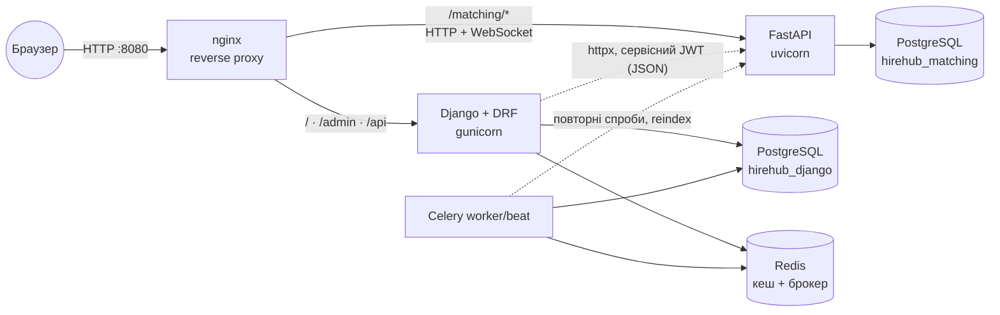
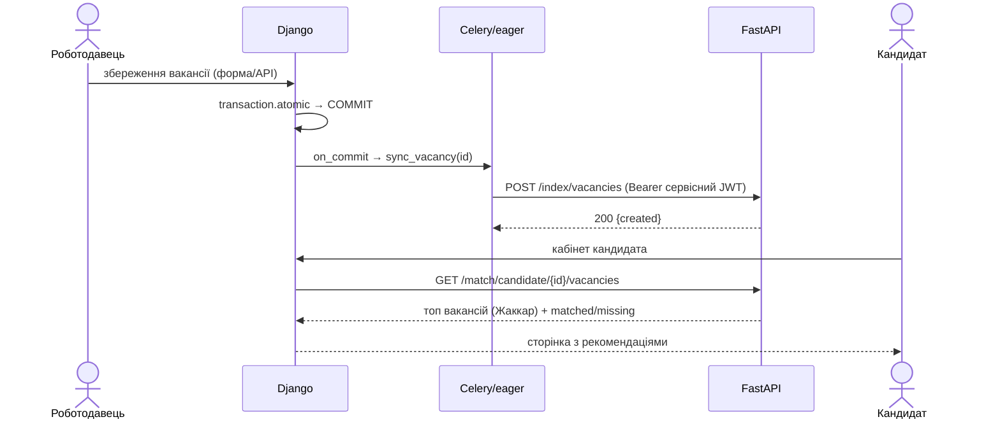
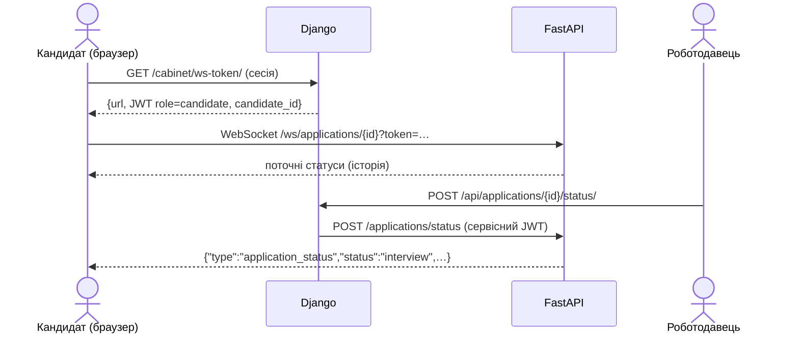

# Архітектура та взаємодія сервісів

## Послідовність: зміна вакансії → індекс → рекомендації

## Послідовність: статус заявки → WebSocket

## Автентифікація між сервісами

* Спільний секрет `SHARED_JWT_SECRET` (змінна середовища, не в репозиторії), алгоритм HS256.
* Django підписує **сервісний JWT** (`iss=hirehub-django`, `role=service`, TTL 5 хв) для кожного запиту.
* Для WebSocket Django видає **короткоживучий токен кандидата** (`role=candidate`, `candidate_id`, TTL 10 хв):
  він не дає доступу до `/match/*`, лише до власного потоку статусів.
* Користувачі FastAPI (`admin`, `service`, `viewer`) мають власні паролі (bcrypt) і отримують токени через `/auth/token`.

## Що, якщо сервіс підбору недоступний

Збереження вакансій і профілів **не залежить** від FastAPI: синхронізація виконується після коміту, помилки логуються
й повторюються з відступом (Celery); сторінки показують порожній блок рекомендацій. Періодичне завдання
`integration.tasks.reindex_all` (щогодини) і команда `manage.py reindex_matching` відновлюють індекс.
