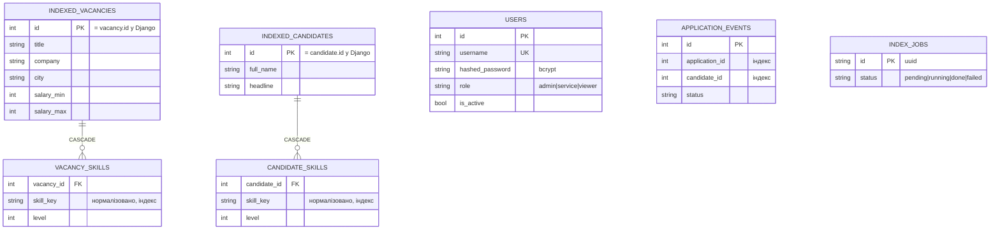

# ER-діаграма FastAPI-сервісу (PostgreSQL `hirehub_matching`)

Сервіс має **власну** БД. Прямого доступу до БД Django немає: дані потрапляють лише через HTTP (`/index/*`).
Ідентифікатори `indexed_vacancies.id` та `indexed_candidates.id` дорівнюють id у Django (не автоінкремент).

